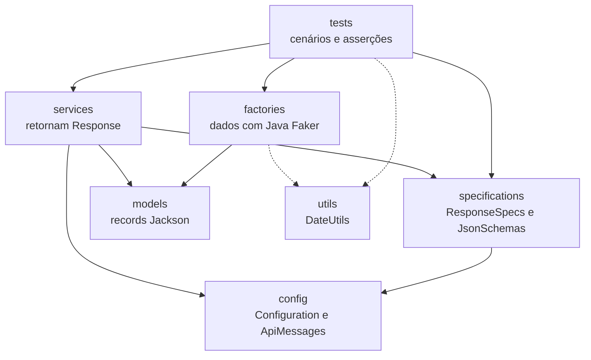
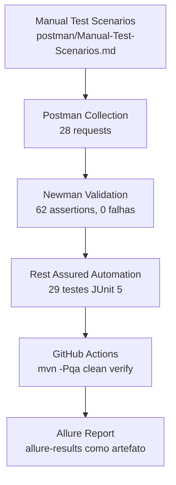
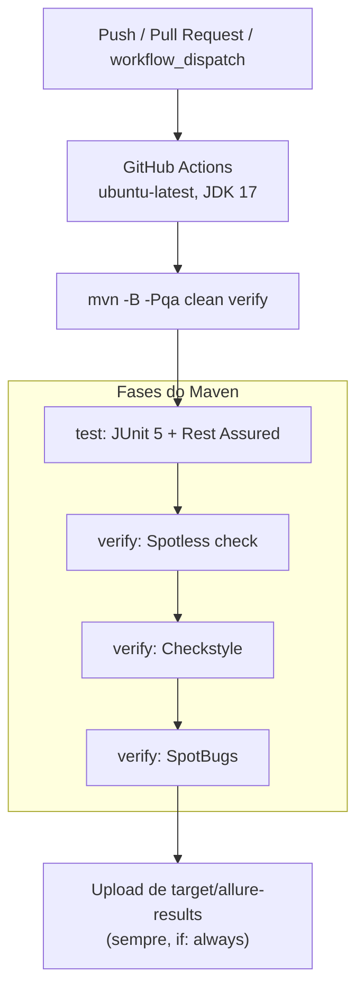

# API Test Automation – Restful Booker

[](https://github.com/LuisBokor/api-test-automation-restful-booker/actions/workflows/ci.yml)


Framework de automação de testes de API em Java para o serviço público [Restful Booker](https://restful-booker.herokuapp.com/apidoc/index.html), com arquitetura em camadas, testes negativos, testes de segurança e validação de contrato via JSON Schema.

> O projeto Maven fica na pasta `api-test-automation-restful-booker/` dentro do repositório; execute os comandos `mvn` a partir dela. O workflow do GitHub Actions fica na raiz do repositório.

## Sumário

- [Sobre o projeto](#sobre-o-projeto)
- [Screenshots](#screenshots)
- [Postman Artifacts](#postman-artifacts)
- [Tecnologias utilizadas](#tecnologias-utilizadas)
- [Arquitetura do framework](#arquitetura-do-framework)
- [Funcionalidades implementadas](#funcionalidades-implementadas)
- [Cobertura dos testes](#cobertura-dos-testes)
- [JSON Schema Validation](#json-schema-validation)
- [Configuração de ambientes](#configuração-de-ambientes)
- [Como executar](#como-executar)
- [Relatórios Allure](#relatórios-allure)
- [Integração contínua](#integração-contínua)
- [Qualidade de código](#qualidade-de-código)
- [Métricas atuais](#métricas-atuais)
- [Melhorias futuras](#melhorias-futuras)
- [Autor](#autor)

## Sobre o projeto

**Objetivo:** validar o comportamento funcional, de segurança e o contrato da API Restful Booker de forma automatizada, repetível e integrada a CI/CD.

**Motivação:** demonstrar, em um projeto pequeno e executável, práticas que se esperam de um framework de automação profissional: separação de responsabilidades, reuso, dados dinâmicos, relatórios e portões de qualidade no pipeline.

**Benefícios:**

- Um novo endpoint exige apenas um novo *service*, sem alterar o que já existe.
- Os testes descrevem a intenção, e os detalhes de HTTP ficam nas camadas inferiores.
- O comportamento real da API (inclusive suas inconsistências) está documentado em testes executáveis.
- O pipeline barra código fora do padrão e publica os resultados Allure como artefato.

## Screenshots

> As imagens abaixo devem ser capturadas e salvas em `docs/` com exatamente estes nomes. O guia de captura está em [docs/README.md](docs/README.md).

### GitHub Actions


### Allure Report


### Postman


## Postman Artifacts

Before implementing the automated tests, all endpoints were manually explored and validated with Postman, covering request and response structures, authentication, business rules and error handling. The resulting artifacts are versioned in the `postman/` folder:

```
postman/
├── RestfulBooker.postman_collection.json
├── RestfulBooker.postman_environment.json
└── Manual-Test-Scenarios.md
```

| Arquivo | Conteúdo |
|---|---|
| `RestfulBooker.postman_collection.json` | Collection com 28 requests organizados em: Health Check, Authentication, Create Booking, Get Booking, Update Booking, Partial Update Booking, Delete Booking, Negative Tests e Security Tests |
| `RestfulBooker.postman_environment.json` | Variáveis de ambiente `baseUrl`, `token` e `bookingId` |
| `Manual-Test-Scenarios.md` | 27 cenários manuais com os resultados esperados e a rastreabilidade para os testes automatizados |

### Validation

- Collection executada com Newman contra a API pública
- 28 requests executados
- 62 assertions executadas
- 0 falhas

### Features

- Automatic token generation and storage: o request *Create Token* grava `token` no environment e os requests protegidos o enviam no header `Cookie`
- Automatic booking ID generation and reuse: o request *Create Booking* grava `bookingId`, reutilizado por consulta, atualização e exclusão
- Dynamic test data generation: nomes e preço usam variáveis dinâmicas do Postman, e as datas são calculadas por um pre-request script da collection
- Positive scenarios: health check, autenticação e CRUD completo
- Negative scenarios: credenciais inválidas, IDs inexistentes e payloads inválidos
- Security scenarios: PUT, PATCH e DELETE sem token e com token inválido
- End-to-end execution flow: as pastas foram ordenadas para rodar em sequência, da autenticação à exclusão

### Execution

```bash
npx newman run postman/RestfulBooker.postman_collection.json \
-e postman/RestfulBooker.postman_environment.json
```

Também é possível importar a collection e o environment no Postman e executar as pastas em ordem.

### Traceability

Os cenários manuais estão mapeados para os testes automatizados. O arquivo `postman/Manual-Test-Scenarios.md` contém a rastreabilidade entre:

- Manual Validation
- Postman Collection
- Rest Assured Tests

## Tecnologias utilizadas

| Tecnologia | Versão | Objetivo |
|---|---|---|
| Java | 17 | Linguagem (`maven.compiler.release` 17) |
| Maven | 3.8+ | Build e gerenciamento de dependências |
| JUnit 5 (Jupiter) | 5.10.2 | Execução de testes, parametrização e tags |
| Rest Assured | 5.4.0 | Cliente HTTP e asserções de API |
| JSON Schema Validator | 5.4.0 | Validação de contrato (`matchesJsonSchemaInClasspath`) |
| Jackson Databind | 2.17.0 | Serialização e desserialização dos models |
| Java Faker | 1.0.2 | Geração de dados dinâmicos |
| Lombok | 1.18.32 | Redução de código repetitivo (builder, construtores) |
| AssertJ | 3.25.3 | Asserções fluentes sobre objetos |
| Allure (junit5 + rest-assured) | 2.27.0 | Relatórios, steps e anexos de request/response |
| AspectJ Weaver | 1.9.22 | Instrumentação dos `@Step` do Allure |
| Maven Surefire | 3.2.5 | Execução dos testes |
| Spotless | 2.43.0 | Formatação (google-java-format) e remoção de imports não usados |
| Maven Checkstyle Plugin | 3.6.0 | Verificações estáticas de estilo durante `verify` |
| SpotBugs Maven Plugin | 4.8.6.6 | Análise estática de bytecode de teste durante `verify` |
| GitHub Actions | – | Integração contínua |

## Arquitetura do framework



### Fluxo de validação e entrega



O fluxo manual valida endpoints e respostas primeiro; os cenários são então expressos em testes automatizados. O mesmo `mvn clean verify` roda localmente e no CI. A execução do Newman é manual (não faz parte do workflow).

### Pipeline de CI



Spotless, Checkstyle e SpotBugs estão vinculados à fase `verify`, portanto rodam depois dos testes dentro do mesmo comando Maven; não são etapas separadas do workflow.

```
postman/                # exploração manual da API (collection, environment, cenários)
src/test
├── java/com/seunome/api
│   ├── config          # Configuration, ApiMessages
│   ├── models          # Booking, BookingDates, BookingResponse, BookingId, AuthRequest
│   ├── factories       # BookingFactory, AuthRequestFactory
│   ├── specifications  # RequestSpecs, ResponseSpecs, JsonSchemas
│   ├── services        # BaseService, AuthService, BookingService, HealthCheckService
│   ├── utils           # DateUtils
│   └── tests           # BaseTest e classes de teste
└── resources
    ├── config.properties
    ├── junit-platform.properties # paralelismo controlado
    └── schemas         # contratos JSON Schema
config/checkstyle/checkstyle.xml
```

| Camada | Responsabilidade |
|---|---|
| `config` | Leitura de configuração (propriedade de sistema, variável de ambiente, arquivo) e constantes de mensagens da API. |
| `models` | Representação dos payloads como `record`s imutáveis, mapeados pelo Jackson. `Booking` usa `NON_NULL`, o que permite reutilizá-lo em atualizações parciais. |
| `factories` | Criação de dados de teste válidos e inválidos. Concentra o uso do Java Faker. |
| `specifications` | Request spec padrão (base URI, content type, filtro Allure) e response specs por status (`ok`, `created`, `forbidden`, `notFound`, `methodNotAllowed`, `badRequest`, `internalServerError`), que também validam content type e tempo de resposta. |
| `services` | Equivalente ao *Page Object* para APIs: um service por recurso, que monta a requisição e **retorna `Response`**. Não contém asserções. |
| `utils` | Utilitários sem estado (formatação de datas). |
| `tests` | Cenários e **todas as asserções**. Dependem apenas de services, factories e specs. |

Fluxo de dependência: `tests → services → specifications → config`, com `models` e `factories` como apoio. Decisões de design:

- Services retornam `Response` para que cada teste decida o que validar, incluindo cenários negativos.
- Um token `null` em `BookingService` envia a requisição sem o cookie de autenticação, o que evita métodos duplicados nos testes de segurança.
- Status HTTP e mensagens de erro vivem em `ResponseSpecs` e `ApiMessages`, sem números ou strings mágicos nos testes.

## Funcionalidades implementadas

| Categoria | Classe de teste | O que cobre |
|---|---|---|
| Health Check | `HealthCheckTest` | `GET /ping` responde `201` e `Created` |
| Authentication | `AuthTest` | Token gerado para credenciais válidas |
| Booking CRUD | `BookingTest` | Criar, consultar, listar, atualizar (PUT), atualizar parcialmente (PATCH) e excluir |
| Security | `BookingSecurityTest` | PUT, PATCH e DELETE sem token e com token inválido |
| Negative Testing | `AuthNegativeTest`, `BookingNegativeTest` | Credenciais inválidas, IDs inexistentes e payloads inválidos |
| Contract Testing | `AuthTest`, `BookingTest` | Respostas validadas contra JSON Schema |
| Resilience | `RetryRequestTest` | Retry GET após resposta 503; confirma que POST não é repetido |

## Cobertura dos testes

**Health Check**
- `shouldReportApiIsUp`

**Authentication**
- `shouldReturnTokenForValidCredentials` (com schema)

**Booking CRUD** (`BookingTest`)
- `shouldCreateBooking` (com schema e comparação do corpo)
- `shouldGetCreatedBookingById` (com schema)
- `shouldListCreatedBookingId` (com schema)
- `shouldUpdateBooking`
- `shouldPartiallyUpdateBooking`
- `shouldDeleteBooking` (confirma `404` na consulta seguinte)

**Autenticação negativa** (`AuthNegativeTest`, um teste parametrizado)

| Cenário | Resultado validado |
|---|---|
| Usuário inválido | `200`, `reason = "Bad credentials"`, sem `token` |
| Senha inválida | idem |
| Usuário vazio | idem |
| Senha vazia | idem |
| Payload vazio | idem |

**Booking negativo** (`BookingNegativeTest`)

| Cenário | Resultado validado |
|---|---|
| GET de ID inexistente | `404`, `Not Found` |
| PUT de ID inexistente | `405`, `Method Not Allowed` |
| PATCH de ID inexistente | `405`, `Method Not Allowed` |
| DELETE de ID inexistente | `405`, `Method Not Allowed` |
| Criar sem `firstname` | `500`, `Internal Server Error` |
| Criar sem `lastname` | `500`, `Internal Server Error` |
| Criar com payload vazio | `500`, `Internal Server Error` |
| Checkout anterior ao checkin | `200`, a API aceita (ausência de validação) |

**Segurança** (`BookingSecurityTest`, cada teste executado com token ausente e token inválido)

| Operação | Resultado validado |
|---|---|
| PUT | `403`, `Forbidden` |
| PATCH | `403`, `Forbidden` |
| DELETE | `403`, `Forbidden`, e o booking continua existindo |

> Os resultados acima refletem o comportamento observado da API, que diverge de convenções REST em pontos como `200` para falha de autenticação, `405` para recurso inexistente e `500` para payload inválido. Os testes documentam esse comportamento e vão falhar se ele mudar.

**Tags JUnit**

| Tag | Aplicação |
|---|---|
| `smoke` | `HealthCheckTest`, token válido em `AuthTest`, criação em `BookingTest` |
| `regression` | Restante de `BookingTest`, `AuthNegativeTest`, `BookingNegativeTest`, `BookingSecurityTest` |
| `security` | `BookingSecurityTest` |

## JSON Schema Validation

Os contratos ficam em `src/test/resources/schemas` e são referenciados por constantes em `JsonSchemas`. Nos testes:

```java
.body(matchesJsonSchemaInClasspath(JsonSchemas.BOOKING))
```

| Schema | Valida |
|---|---|
| `auth-response-schema.json` | Resposta de `POST /auth` (`token` string não vazia) |
| `booking-schema.json` | Booking (tipos dos campos, datas `YYYY-MM-DD`, `additionalneeds` opcional) |
| `create-booking-response-schema.json` | `bookingid` + `booking`, reutilizando `booking-schema.json` via `$ref` |
| `booking-id-schema.json` | Lista de `{ "bookingid": n }` retornada por `GET /booking` |

Os schemas usam `additionalProperties: false`, portanto campos inesperados na resposta quebram o teste. Como verificação, trocar o tipo de `totalprice` no schema faz os testes de criação e de consulta falharem.

## Dados dinâmicos

`BookingFactory` usa **Java Faker** para gerar nome, sobrenome, preço, depósito, necessidades adicionais e datas (checkin futuro e checkout posterior). Cada execução usa dados novos, o que evita colisões e dependência de dados pré-existentes. Para variações, `validBookingBuilder()` devolve o builder do Lombok, e cenários inválidos são derivados dele (por exemplo, `firstname(null)`).

## Configuração de ambientes

`Configuration` resolve cada chave nesta ordem de prioridade:

1. Propriedade de sistema: `-Dbase.url=...`
2. Variável de ambiente: `BASE_URL`
3. Profile Maven ativo (`dev`, `qa` ou `prod`)
4. Arquivo `src/test/resources/config.properties`

```properties
base.url=https://restful-booker.herokuapp.com
auth.username=admin
auth.password=password123
```

Chaves disponíveis: `base.url` (`BASE_URL`), `auth.username` (`AUTH_USERNAME`) e `auth.password` (`AUTH_PASSWORD`). As credenciais do arquivo são as públicas documentadas pela API; para outros ambientes, sobrescreva-as por variável de ambiente.

```bash
mvn test -Pdev
mvn test -Pqa
mvn test -Pprod

mvn test -Pqa -Dbase.url=https://qa.example.com
BASE_URL=https://qa.example.com mvn test -Pqa
```

Os três profiles usam a URL do Restful Booker como valor inicial porque o repositório não contém endpoints próprios de desenvolvimento, QA ou produção. Configure `BASE_URL` (ou `-Dbase.url`) para apontar a um ambiente separado. O profile `prod` bloqueia URLs diferentes da API demo por padrão: a suíte cria, atualiza e exclui bookings. Só use `-Dallow.destructive.prod=true` após autorização explícita para executar testes destrutivos no destino.

## Como executar

**Pré-requisitos:** JDK 17 e Maven 3.8+.

```bash
# Executa os testes
mvn test

# Build completo: testes + Spotless + Checkstyle + SpotBugs
mvn clean verify

# Verifica a formatação
mvn spotless:check

# Corrige a formatação automaticamente
mvn spotless:apply

# Executa por tag
mvn test -Dgroups=smoke
mvn test -Dgroups=security
mvn test -Dgroups=regression

# Executa uma classe
mvn test -Dtest=BookingTest
```

O `spotless:check` está vinculado à fase `verify`, portanto `mvn test` não o executa.

### Cleanup de dados

`BaseTest` registra os IDs retornados pelos helpers de criação e remove os bookings em `@AfterEach`, usando token válido e `BookingService`. Cada remoção bem-sucedida é registrada no log; falhas são logadas e fazem o teste falhar em vez de deixar o resíduo passar silenciosamente. O teste de delete explícito remove o ID do registro após confirmar a exclusão, evitando uma segunda tentativa.

### Execução paralela e resiliência

JUnit executa até dois testes em paralelo (`junit-platform.properties`). Cada invocação tem seus próprios IDs de booking, token em cache local ao teste e instância própria de Java Faker; o cleanup roda por teste.

Request specs aplicam timeout de conexão e leitura. Os métodos GET do `BaseService` têm retries limitados para `429`, `502`, `503` e `504`, além de falhas de transporte; POST/PUT/PATCH/DELETE nunca são repetidos automaticamente, evitando criação ou alteração duplicada. O comportamento é coberto por testes locais em `RetryRequestTest`. Valores podem ser configurados por propriedades de sistema ou variáveis de ambiente:

| Propriedade | Variável | Padrão |
|---|---|---:|
| `http.connection.timeout.ms` | `HTTP_CONNECTION_TIMEOUT_MS` | 5000 |
| `http.socket.timeout.ms` | `HTTP_SOCKET_TIMEOUT_MS` | 10000 |
| `http.retry.max.attempts` | `HTTP_RETRY_MAX_ATTEMPTS` | 2 |
| `http.retry.delay.ms` | `HTTP_RETRY_DELAY_MS` | 250 |

O número máximo de tentativas inclui a chamada inicial. Configurações numéricas inválidas ou não positivas falham explicitamente.

## Relatórios Allure

Os resultados são gravados em `target/allure-results`. Com a [Allure CLI](https://allurereport.org/docs/install/) instalada:

```bash
allure serve target/allure-results
```

O relatório inclui a hierarquia Epic/Feature, os `@Step` de cada chamada de service e os anexos de request e response (com o comando `curl` equivalente) gerados pelo `AllureRestAssured`.

## Integração contínua

Workflow: [`../.github/workflows/ci.yml`](../.github/workflows/ci.yml) (**API Tests**, na raiz do repositório).

- **Gatilhos:** `push` em `main` ou `master`, `pull_request` e execução manual (`workflow_dispatch`).
- **Ambiente:** `ubuntu-latest`, Temurin JDK 17, com cache do Maven.
- **Etapas:**
  1. Executa `mvn -B -Pqa clean verify` (testes, Spotless, Checkstyle e SpotBugs).
  2. Publica `target/allure-results` como artefato, mesmo em caso de falha.
- O job aceita `BASE_URL` como variável de repositório/organização. Sem ela, usa a URL pública demo.

O relatório HTML pode ser gerado localmente com a Allure CLI (`allure serve target/allure-results`). O workflow armazena os resultados brutos como artefato; não publica automaticamente em GitHub Pages.

## Qualidade de código

- **Spotless:** `google-java-format` e `removeUnusedImports`, com `check` no ciclo `verify`. Código fora do padrão quebra o build local e o CI; use `mvn spotless:apply` para corrigir.
- **Checkstyle:** regras explícitas para imports, chaves e imports wildcard, aplicadas a fontes de teste durante `verify`.
- **SpotBugs:** análise de bytecode de teste com esforço máximo e nível de severidade alto, como gate do `verify`.
- **Clean Code:** nomes em inglês que descrevem a intenção, métodos curtos, sem números ou strings mágicos, comentários apenas onde o comportamento da API é contraintuitivo.
- **SOLID:**
  - *Single Responsibility:* cada camada e classe tem uma responsabilidade (service monta requisição, spec define expectativas, factory gera dados).
  - *Open/Closed:* novos recursos entram como novos services, models e factories, sem modificar os existentes.
  - *Dependency Inversion (parcial):* os testes dependem de services e specs, não de detalhes de HTTP.
- **DRY:** cenários repetitivos usam `@ParameterizedTest`; token, base URI, content type e schemas ficam centralizados.

## Métricas atuais

| Métrica | Valor |
|---|---|
| Testes automatizados (execuções, contando parametrizados) | 29 |
| Requests Postman | 28 |
| Assertions Newman | 62 |
| JSON Schemas | 4 |
| Classes de teste | 7 (mais `BaseTest`) |
| Services | 3 (mais `BaseService`) |
| Factories | 2 |
| Models | 5 |
| CI/CD | GitHub Actions |
| Relatórios | Allure Report |
| Qualidade de código | Spotless, Checkstyle e SpotBugs |

## Melhorias futuras

- [ ] Testes dos filtros de `GET /booking` (`firstname`, `lastname`, `checkin`, `checkout`).
- [ ] Executar smoke antes de regression como etapas separadas no CI.
- [ ] Separar serviços reais de dev/QA/prod (as URLs não estão presentes neste repositório).
- [ ] Análise de dependências e geração de SBOM.
- [ ] Testes de desempenho básicos de tempo de resposta.

## Avaliação técnica

| Dimensão | Avaliação após as melhorias |
|---|---|
| Arquitetura e responsabilidades | 9/10 — camadas coesas e asserções fora dos services; framework ainda concentrado em `src/test/java`. |
| Isolamento e estabilidade | 9/10 — dados isolados, cleanup por teste, timeouts e retry seguro para GET; serviço público continua sujeito a indisponibilidade e rate limiting. |
| Qualidade e CI | 9/10 — Spotless, Checkstyle, SpotBugs e testes são gates de `verify`; falta análise de dependências/SBOM. |
| Portfólio | 9/10 — cobertura positiva, negativa, segurança, contratos, Postman e rastreabilidade; nomes do pacote e badges ainda são placeholders. |

**Nota consolidada estimada:** 8,5/10 antes desta evolução e 9,3/10 após ela. A nota é uma avaliação qualitativa, não uma métrica automatizada. Para se aproximar de um framework corporativo, o próximo passo é executar contra ambientes controlados próprios, separar configuração e credenciais por ambiente, introduzir teste de contrato independente da API pública e adicionar análise de dependências e SBOM.

## Autor

- **Nome:** `<Seu Nome>`
- **LinkedIn:** `https://www.linkedin.com/in/<seu-usuario>`
- **GitHub:** [github.com/LuisBokor](https://github.com/LuisBokor)
